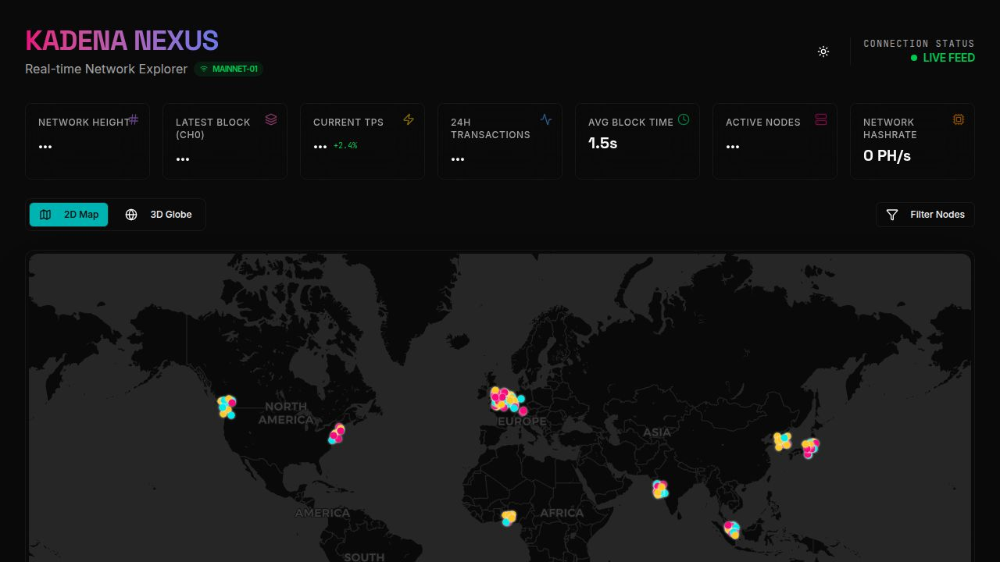

# Kadena Nexus

Real-time Network Explorer for the Kadena blockchain. Monitor network statistics, block times, and chain activity through an interactive dashboard with 2D map and 3D globe visualizations.



## Features

- **Live Network Stats** - Real-time TPS, block height, and transaction counts
- **Average Block Time** - Accurate block time calculation across all 20 chains
- **Interactive 2D Map** - Leaflet-based world map with dark/light themes
- **3D Globe View** - WebGL-powered interactive Earth visualization
- **Auto-refresh** - Data updates every 10 seconds
- **Responsive Design** - Works on desktop and mobile devices

## Tech Stack

**Frontend:**
- React 19 + TypeScript
- Vite 7
- Tailwind CSS 4
- Three.js (3D Globe)
- Leaflet + React-Leaflet (2D Map)
- TanStack Query
- Framer Motion

**Backend:**
- Express 5
- TypeScript
- Chainweb API integration

## Prerequisites

- Node.js 18+ 
- npm or yarn

## Installation

1. **Clone the repository:**
```bash
git clone https://github.com/yourusername/kadena-nexus.git
cd kadena-nexus
```

2. **Install dependencies:**
```bash
npm install
```

3. **Start development servers:**

Run both frontend and backend:
```bash
npm run dev:all
```

Or run them separately:
```bash
# Terminal 1 - Backend server (port 3000)
npm run dev:server

# Terminal 2 - Frontend dev server (port 5173)
npm run dev
```

4. **Open in browser:**
```
http://localhost:5173
```

## Scripts

| Command | Description |
|---------|-------------|
| `npm run dev` | Start Vite frontend dev server |
| `npm run dev:server` | Start Express backend server |
| `npm run dev:all` | Start both servers concurrently |
| `npm run build` | Build for production |
| `npm run preview` | Preview production build |

## API Endpoints

### Core Network API

| Endpoint | Description |
|----------|-------------|
| `GET /api/core/network/summary` | Network cut data and chain heights |
| `GET /api/core/network/metrics` | TPS, block time, transaction stats |

### Chainweb API

| Endpoint | Description |
|----------|-------------|
| `GET /api/chainweb/cut` | Current network cut |
| `GET /api/chainweb/chain/:chainId` | Specific chain data |
| `GET /api/chainweb/chains` | All chains data |
| `GET /api/chainweb/stats` | Comprehensive network stats |
| `POST /api/chainweb/cache/clear` | Clear API cache |

### Documentation

| Endpoint | Description |
|----------|-------------|
| `GET /api-docs` | Swagger API documentation |
| `GET /health` | Health check endpoint |

## Project Structure

```
kadena-nexus/
├── client/                 # Frontend React app
│   ├── src/
│   │   ├── components/     # React components
│   │   ├── hooks/          # Custom React hooks
│   │   ├── lib/            # Utilities
│   │   └── pages/          # Page components
│   └── public/             # Static assets
├── _server/                # Backend Express server
│   ├── config/             # Server configuration
│   ├── services/           # Business logic
│   └── routes.ts           # API routes
├── shared/                 # Shared types/schemas
└── api/                    # Additional API modules
```

## Configuration

### Environment Variables

Create a `.env` file in the root directory:

```env
# Optional: Custom API base URL
VITE_API_BASE_URL=/api

# Server port (default: 3000)
PORT=3000
```

### Vite Proxy

The frontend proxies `/api` requests to the backend server. This is configured in `vite.config.ts`.

## Block Time Calculation

The average block time is calculated using the correct formula:

1. Fetch recent block headers for each chain using the Chainweb API
2. Calculate time differences between consecutive blocks:
   ```
   dt = creationTime[i] - creationTime[i-1]
   ```
3. Convert from microseconds to seconds (÷ 1,000,000)
4. Average per chain, then average across all 20 chains

## Data Sources

- **Chainweb API** (Primary): `https://api.chainweb-community.org/chainweb/0.0/mainnet01`
- **Chainweb API** (Fallback): `https://chainweb.chaddex.com/chainweb/0.0/mainnet01`

## Globe Controls

The 3D globe supports full interactive controls:

| Control | Action |
|---------|--------|
| Left mouse drag | Rotate globe |
| Right mouse drag | Pan camera |
| Mouse wheel | Zoom in/out |
| Arrow keys / WASD | Pan camera |
| +/- keys | Zoom |
| Double-click | Reset view |

## Building for Production

```bash
# Build the application
npm run build

# Preview the build
npm run preview
```

The build output will be in the `dist/` directory.

## License

MIT

## Contributing

1. Fork the repository
2. Create a feature branch
3. Commit your changes
4. Push to the branch
5. Open a Pull Request

## Acknowledgments

- [Kadena](https://kadena.io/) - Blockchain platform
- [Chainweb](https://github.com/kadena-io/chainweb-node) - Kadena's public blockchain
- [Three.js](https://threejs.org/) - 3D graphics library
- [Leaflet](https://leafletjs.com/) - Interactive maps
